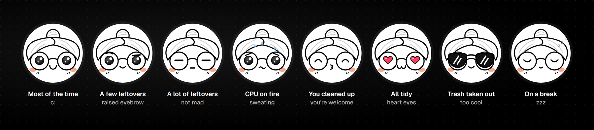
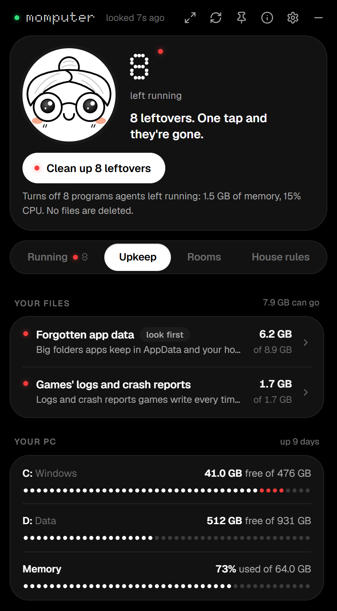
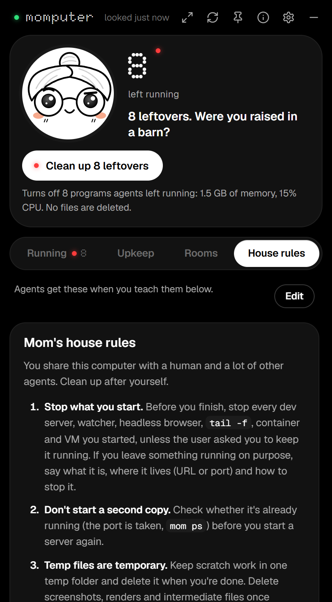

<p align="center">
  
</p>

<p align="center">
  
  
  
  
  
  <a href="https://github.com/Thisisily/momputer/actions/workflows/ci.yml"></a>
</p>

<p align="center"><b>Your AI agents leave the stove on. Mom turns it off.</b><br>
<sub>A Windows tray widget for people who run Claude Code, Codex, Cursor, Gemini or Copilot: it finds leftover dev servers, watchers, headless browsers, old <code>node_modules</code> and caches, says which agent left them, and cleans them up.</sub></p>

<p align="center">
  
</p>

---

If you run a lot of coding agents, you know the feeling. Claude starts a dev server, Codex starts a watcher, somebody launches a headless browser "just to check", and then the session ends and nobody turns anything off. A week later Task Manager has 70 `node.exe`, 17 `bun.exe` and a `tail -f` from two weeks ago, your disk is full of scratch folders, and your CPU is melting.

**momputer** is a little Windows tray widget (plus a `mom` command line) that keeps an eye on all of it. She knows which agent started what, tells you what was left behind, and cleans up after them, but only after showing you exactly what she's about to do.

## Meet mom

<p align="center">
  
</p>

She looks around every few seconds. A tiny light next to her name blinks each time, and lights on every row tell you how things are: **green** when someone's using it, **red** when nobody is. She follows your pointer with her eyes, blushes when you hover over her, and giggles when you click her. Click her five times and she gets dizzy.

<p align="center">
  
</p>

## What she does

<table>
  <tr>
    <td width="44%"></td>
    <td>
      <h3>Running</h3>
      <p>Every dev server, watcher, headless browser, database, tunnel, container and VM on the machine, grouped into the thing that was started, with its ports, memory, CPU and <b>who started it</b>.</p>
      <p>What's been left behind goes to the top, with one button that turns it all off. Below that: the agents that are awake right now (Claude Code sessions, Codex threads and their schedules) and what each one is running.</p>
      <p>When leftovers start eating your CPU at 3 a.m., she tells you. If you let her, she turns them off herself.</p>
    </td>
  </tr>
  <tr>
    <td width="44%"></td>
    <td>
      <h3>Upkeep</h3>
      <p>Four tabs: <b>Storage</b> (below), <b>Apps</b> (apps you haven't opened in a year, what starts with Windows, what uses the most memory), <b>Windows</b> (settings that drifted, see the checkup) and <b>Files</b> (copies of the same file and big files nobody has opened in a year, in your own folders). Storage is everything that can go, and exactly what it is:</p>
      <ul>
        <li>Claude Code's scratch from finished sessions, named after what each session was doing</li>
        <li>what agent tools leave lying around: logs, temp files, undo snapshots, pasted text, caches and old Cursor worktrees, from Claude Code and the Claude app, Codex and its app, OpenCode, OpenClaw, Hermes, Pi, Copilot, Gemini, Qwen, Goose, Cline, Roo, Kilo, Continue, Kimi, Vibe, Junie, Mux, Crush, Droid, Zed, Warp, Windsurf, Kiro, Aider and more. All of it is kept for 67 days first, and nothing they need (chats, sessions, settings, skills, memory) is ever touched</li>
        <li>old builds, downloaded extension packages and crash reports VS Code and its forks keep, older versions Squirrel apps (Slack, Discord, GitHub Desktop) and Chrome keep, and the update installers apps leave behind</li>
        <li>shaders your graphics driver compiled for games you no longer play, games' logs and crash reports (never saves), and developer caches with no clean-up of their own (Dart, Flutter, Cypress, act, Firebase, VS Code's C++ and TypeScript caches)</li>
        <li>old <code>node_modules</code> and <code>target</code> folders in projects you stopped working on</li>
        <li>npm, bun, pip, uv, cargo and other developer caches. npx downloads wait 67 days (npx never notes when a package last ran) and stay if your shell history or an MCP server set-up runs them; Hugging Face models only go if you tick them</li>
        <li>Docker's build cache and untagged images, and any images and stopped containers you tick: each image is listed with the containers that use it, and volumes are never touched</li>
        <li>browser caches (and the same caches inside Cursor, VS Code, Slack and other apps built like browsers), crash dumps, old installers in Downloads, and the Recycle Bin</li>
        <li>things only an administrator can delete: Windows Update's leftover downloads, old error reports, installer folders at the root of C:, older driver installers, old app backups and crash dumps in ProgramData. Mom itself never runs as administrator: when you press the button, Windows asks first, and an elevated copy of the <code>mom</code> command cleans exactly what it finds under the same rules. This only works when momputer is installed for all users, so that nothing running as you could have swapped that copy</li>
        <li><b>forgotten app data</b>: big folders of apps you uninstalled, an app's older versions, and models and games you haven't opened in ages. Mom guesses which app a folder belongs to, so these move to your archive drive instead of being deleted, and keys, passwords, wallets, browser profiles and messages are never offered</li>
      </ul>
      <p>Tap any of them and she lists every folder that goes, every one that stays and why, and tells you what the button does (deleted for good, Recycle Bin, or the tool's own prune) <b>before</b> you press it. Untick anything you want to keep, or tick something she'd keep just because it's new. Long lists are grouped by app or game (all of Unity's logs together, then each game), and can be sorted and filtered. While she cleans, you watch each item go, and Stop halts it after the one she's on.</p>
      <p><b>Old conversations</b> don't get deleted: mom moves them to another drive (an external one is fine) and leaves a link in each one's place, so Codex, Claude Code, Cursor and the rest still open them from where they were. Bring back puts any of them back.</p>
    </td>
  </tr>
  <tr>
    <td width="44%"></td>
    <td>
      <h3>A checkup for your PC</h3>
      <p>Free space on every drive as a dot meter that turns red when it's nearly full, how much memory is in use and by whom, how long since you restarted, whether Windows is waiting to finish an update, whether Storage Sense is on, and every app that starts with Windows.</p>
      <p>Each tip has a button straight to the right Windows Settings page. Apps you haven't opened in a year (judged by when Windows saw you start them and when their data last changed) are listed with an Uninstall button that opens their own uninstaller. Runtimes, drivers, terminal tools, wallets and messengers are never listed.</p>
      <p><b>Windows settings</b> that drifted over the years: old speed-up tweaks that do nothing today (a fixed page file, XP-era memory values), services switched off, a screen running below its refresh rate, a proxy nobody answers, and leftovers pointing at things that are gone (PATH folders, variables, startup entries). Each says what it does to you now and how Windows ships it. Fixes to your own settings are backed up and can be undone; the ones that need an administrator put back Windows' default, and Windows asks first.</p>
    </td>
  </tr>
  <tr>
    <td width="44%"></td>
    <td>
      <h3>Rooms</h3>
      <p>Point her at a messy folder and she grades it. She catches dated report folders at the top level, <code>thing-v2</code> / <code>thing-v3</code> / <code>thing-final</code> sprawl, screenshot piles, empty shells and typo'd folder names.</p>
      <p>You get a plan you can apply and undo with one click, or a chore list you can paste to the agent that made the mess.</p>
      <p>She's careful about it. A folder full of projects is a workspace: she never moves or groups the projects (tools and agents find them by path) and only tidies inside them. In your own folders and in code, she ticks only what's plainly throwaway, and you tick the rest. Whole drives, Windows, installed programs, apps' data and your profile folder itself can't be rooms at all.</p>
    </td>
  </tr>
  <tr>
    <td width="44%"></td>
    <td>
      <h3>House rules</h3>
      <p>One set of rules ("stop what you start", "reports go in <code>Documents/</code>", "one thing, one folder"…). She writes them into Claude Code's and Codex's instructions, and hooks make her check in before an agent says it's done.</p>
    </td>
  </tr>
</table>

## Install

Run the installer from [Releases](https://github.com/Thisisily/momputer/releases). It installs for all users, in Program Files, so Windows asks for an administrator once, and the clean-ups that need an administrator only work from a copy installed this way. Releases are built by GitHub Actions; signing through [SignPath Foundation](#code-signing-policy) is being set up, and until it is, Windows will warn that the installer is from an unknown publisher.

Or build it from source:

```powershell
git clone https://github.com/thisisily/momputer
cd momputer
.\scripts\build.ps1
```

You need Rust 1.90+, the MSVC build tools and WebView2 (already on Windows 11). The script builds `mom.exe` and the installer (`target\release\bundle\`). To try it without installing:

```powershell
cargo build --release -p mom-cli -p momputer
.\target\release\momputer.exe
```

Run from a folder of your own like this, it all works except the clean-ups that need an administrator: mom won't ask for one from a folder anything running as you could change.

Mom lives in the tray. Left-click her to show or hide the widget, and right-click for "Clean up leftovers". Closing the widget just tucks it away. Drag it by mom or any empty spot.

## The `mom` command

```text
mom                    quick look
mom ps [--all]         everything running, who started it, what was left behind
mom leftovers          only what was left behind
mom mine               what *your* session left running (run it from inside an agent)
mom stop leftovers     stop everything left behind
mom stop mine          stop what your session started
mom stop 1234 :5173    stop by PID or port (the whole tree)
mom sessions           agent sessions running right now
mom machines           Docker, WSL and Hyper-V
mom trash              what can go, and what each clean-up does (mom trash <id> lists the files)
mom trash clean all    take out the safe trash (never the Recycle Bin or your own files)
mom health             drives, memory, restarts, Storage Sense and startup apps
mom files              copies of the same file, and big files nobody opened in a year (only looks)
mom settings           Windows settings that drifted from the defaults (fix <id>, undo <id>)
mom tidy <folder>      grade a folder and list what to fix (--apply, --prompt)
mom undo               undo the last tidy-up
mom rules              the house rules, and who knows them
mom install all        hooks, skill and the CLI for Claude Code and Codex
```

The read-only commands take `--json` for scripts and agents.

## Give every agent a mom

**The skill.** [`skills/mom`](skills/mom/SKILL.md) is a standard Agent Skill. It works in Claude Code (`~/.claude/skills/mom`) and Codex (`~/.agents/skills/mom`): it teaches an agent to check what it left running, stop it, take out its own trash and put reports where they belong. It works with or without momputer installed.

**The hooks.** `mom install claude-hooks codex-hooks` (or the switches under House rules) adds three hooks:

- `SessionStart` remembers what the project folder looked like and hands the agent the house rules.
- `Stop` runs when the agent thinks it's done. If it left servers running or dropped new clutter in the project root, mom asks it to deal with that first. She mentions each thing once, never blocks twice in a row, and stays silent on any error.
- `SessionEnd` notes what the session left behind, and can stop it if you turn that on.

Codex asks you to trust new hooks once: run `/hooks` in the Codex CLI.

**The rules.** Edit them in the app or in `~/.momputer/house-rules.md`. Mom can write them into `~/.claude/CLAUDE.md`, `~/.codex/AGENTS.md` and `~/.gemini/GEMINI.md` inside a clearly marked block, and take them out again without touching anything else.

## How mom knows who did it

Agents stamp their fingerprints on everything they launch, and the stamp survives after the agent is gone:

| Variable | Set by |
| --- | --- |
| `CLAUDECODE`, `CLAUDE_CODE_SESSION_ID`, `CLAUDE_PID`, `AI_AGENT=claude-code_<version>_<agent\|harness>` | Claude Code |
| `CODEX_THREAD_ID`, `CODEX_SANDBOX`, `CODEX_CI` | Codex |
| `CURSOR_AGENT` | Cursor |
| `GEMINI_CLI` | Gemini CLI |
| `COPILOT_AGENT`, `COPILOT_CLI`, `COPILOT_AGENT_SESSION_ID` | GitHub Copilot |
| `AI_AGENT`, `AGENT` | Goose, Amp and others |

momputer reads those markers (and only those: never the rest of a process's environment) and combines them with the process tree:

1. **Is the agent still around?** Claude Code records the PID of the session that launched each command. If that process is gone, whatever it started is *left behind*.
2. **Is the parent really the parent?** Windows reuses PIDs. A "parent" that started after its child is an impostor, so the child is an *orphan*.
3. **Harness or task?** Claude Code marks its own MCP servers `_harness` and the commands it runs `_agent`, so mom never nags about an agent's helpers, only about what it chose to start.
4. **Circumstantial evidence.** Git Bash's `sleep` and `tail` can't carry markers, so mom also uses fingerprints in paths (Claude's scratch folders are named after the session) and timing (started in the same folder after a live session began).
5. **Nobody's?** Dev runtimes whose parent is gone and carry no fingerprints are *orphaned*. Your own browser, your terminal's processes and apps' bundled runtimes (Adobe's private `node.exe`, say) are left alone.

Codex runs every conversation inside one app process, so processes alone can't tell its threads apart. Mom also reads Codex's own records, read-only: thread names, folders and last activity from `~/.codex/state_*.sqlite`, and scheduled automations from `~/.codex/automations`. That's how the widget can say *Codex in storefront: "Ship the launch video", working now, scheduled 14 times a day, next around 13:00*, with a button that opens the thread in Codex.

Listing the machine costs a single `NtQuerySystemInformation` call. Only runtimes, shells and agents get a closer look, and the widget remembers what it has already read, so mom stays light even with a thousand processes and an antivirus in the way. Slow questions (Docker, WSL, measuring folders) run on their own threads, so the widget never waits on them.

## What mom will never do

- Stop Windows' own processes, an agent itself, or whoever asked her (the agent and shell running `mom`).
- Stop a recycled PID: she re-checks every process's start time right before stopping it.
- Move your conversations without asking. They only move when you press the button, a folder at a time: copied, checked file by file, linked, and only then removed from where they were. If anything goes wrong on the way, it's all put back.
- Delete anything without showing you first. Every clean-up lists what goes and what stays, and nothing happens until you press its button and then press again to confirm. Anything in use can't be ticked at all.
  - Tidying moves things, and undo is one click.
  - Your own files, like old installers, go to the Recycle Bin.
  - Temp folders, caches and build folders are deleted for real, because they come back.
  - The Recycle Bin is only emptied when you ask.
- Touch anything you marked "keep", anything matching `protect` in the config, or anything started with `MOMPUTER_KEEP=1`.
- Edit an agent's settings file without backing it up first (`~/.momputer/backups`), or at all if she can't parse it.
- Send anything anywhere. momputer has no network code.
- Hand your "yes" to the wrong program. Before Windows asks you to let `mom` run as administrator, she checks that nothing running as you could have swapped it: it has to be installed for all users (in Program Files), and when momputer is signed, `mom.exe` has to carry the very same signature. Run as administrator, `mom` only looks, and cleans the spots that need one.

## Settings

`~/.momputer/config.toml`, or the gear in the widget. The ones worth knowing:

```toml
protect = ["ollama serve"]    # never touch these (matched against the command line)

[leftovers]
autoStop = false              # turn off agents' leftovers on my own...
autoStopAfterMinutes = 20     # ...once nobody has come back for them this long
autoStopOrphans = false       # also orphans nobody can be traced to

[ui]
notifications = true          # the master switch (also in the widget's settings)
notifyLeftovers = true        # "somebody left the lights on"...
notifyAfterMinutes = 10       # ...only for leftovers nobody came back for in this long
notifyEveryMinutes = 30       # ...and at most one note this often
notifyMeltdown = true         # leftovers burning CPU for two minutes, at most hourly
cpuAlertPercent = 25.0        # meltdown alarm threshold
notifyCleanups = true         # what mom turned off by herself

[hooks]
enabled = true
stopOnSessionEnd = false

[trash]
agentScratchDays = 67         # what agents leave behind stays this long before mom suggests clearing it
conversationsAfterDays = 67   # conversations nobody opened this long can move to another drive...
archiveDir = 'F:\momputer-archive'  # ...here (pick it in the widget)
tempMinAgeDays = 7            # other temp files
```

## Contributing

- **Teach mom a new agent:** add its markers to `mark_from_env` and its process to `agent_process` in [`crates/mom-core/src/agents.rs`](crates/mom-core/src/agents.rs).
- **Teach mom a new runtime or naming trick:** [`classify.rs`](crates/mom-core/src/classify.rs) has tables and real-world test cases.
- **Find more trash:** each clean-up is a spot in [`trash.rs`](crates/mom-core/src/trash.rs) with what it is, what cleaning does and the items it found. Another agent tool's leftovers and conversations go in `agents()` in [`trash/harness.rs`](crates/mom-core/src/trash/harness.rs): where it lives, which folders hold leftovers, and which hold one conversation each. PC checkups live in [`health.rs`](crates/mom-core/src/health.rs).
- **Give mom new lines:** [`voice.rs`](crates/mom-core/src/voice.rs).
- **Work on the widget:** it's plain HTML, CSS and JS in [`app/ui`](app/ui), with no build step. Every list with tick boxes gets a Tick all / Untick all (`tickAllButton` in `app.js`), and anything that deletes or moves asks "Sure?" on the first press. Serve the folder (`python -m http.server -d app/ui`) and it runs in any browser with realistic mock data. Its libraries and fonts are pinned in `package.json` and copied into `app/ui/vendor` by `npm install && npm run vendor`. The copies are committed, so building the app never needs npm.
- **Give mom a new face:** she's drawn in SVG in [`app/ui/mom.js`](app/ui/mom.js), with eyes, brows, mouths and extras combined per mood, and animated with GSAP. [`app/art/mom-reference.webp`](app/art/mom-reference.webp) is the reference sheet she's drawn from. `node scripts/icons.js` redraws the app and tray icons from the same SVG.

`cargo test` runs the core tests, including one that rebuilds a real cluttered folder and checks mom grades it F, tidies it, and puts everything back.

## Code signing policy

Free code signing provided by [SignPath.io](https://about.signpath.io), certificate by [SignPath Foundation](https://signpath.org).

- Committers and reviewers: [Thisisily](https://github.com/Thisisily)
- Approvers: [Thisisily](https://github.com/Thisisily)

Every release is built from this repository by GitHub Actions ([`release.yml`](.github/workflows/release.yml)) and signed only after an approver approves it in SignPath. What gets signed is `momputer.exe`, `mom.exe` and the two installers, all built from the source here ([artifact configurations](.signpath/artifact-configurations)). How it's set up: [docs/signing.md](docs/signing.md).

Privacy policy: This program will not transfer any information to other networked systems unless specifically requested by the user or the person installing or operating it.

## Roadmap

- winget.
- macOS and Linux (the core is mostly portable already).
- An MCP server, so agents can ask mom directly.
- More mom: bedtime (a nightly tidy-up), screen time for agents, a nudge when a disk is nearly full.

## Built with

- [Tauri](https://tauri.app) for the widget.
- [GSAP](https://gsap.com) for mom's animation, free under GreenSock's [standard license](https://gsap.com/standard-license).
- [idiomorph](https://github.com/bigskysoftware/idiomorph) (0BSD), so lists update in place.
- [Geist](https://vercel.com/font) and [Doto](https://github.com/oliverlalan/Doto) fonts, under the SIL Open Font License.
- [Lucide](https://lucide.dev) icons (ISC).
- [Simple Icons](https://simpleicons.org) (CC0) for the coin and GitHub marks.
- [three.js](https://threejs.org) (MIT), for something you'll have to find.

## Made by

momputer is made by Ilya Arbabi. My desktop was a mess, and every AI agent I worked with made it worse, so I built my computer a mom. Also by me: [Marsell](https://getmarsell.com) and [Ilisium](https://ilisium.xyz).

momputer is free. If she saved you an afternoon, you can buy mom a coffee:

| | |
|---|---|
| Solana | `5qT8edyi62wwLz9UBTiRVoN3S9UXLjbV2YVEu4GJH3zH` |
| Zcash | `t1cYbXWEXXc6kZYR1JjkE2qRCEmzCpMA371` |
| Ethereum | `0xfFa448F43896Cf8227aAceF3A72b80450e1fF86E` |
| Bitcoin | `bc1qmnw03rsastc08g6zutgx2sdarzapz82q5nn2kd` |

## License

MIT. See [LICENSE](LICENSE).

The Marsell and Ilisium logos on the About page belong to those projects and aren't covered by the MIT license.
