<p align="center">
  <picture>
    <source media="(prefers-color-scheme: dark)" srcset="docs/readme/hero-dark.png">
    <source media="(prefers-color-scheme: light)" srcset="docs/readme/hero-light.png">
    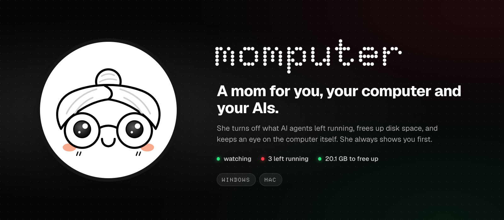
  </picture>
</p>

<p align="center">
  <a href="#install"><b>Install</b></a> &nbsp;·&nbsp;
  <a href="#what-she-does">What she does</a> &nbsp;·&nbsp;
  <a href="#big-mode">BIG MODE</a> &nbsp;·&nbsp;
  <a href="#windows-and-mac">Windows and Mac</a> &nbsp;·&nbsp;
  <a href="#for-your-agents">For your agents</a> &nbsp;·&nbsp;
  <a href="https://thisisily.github.io/momputer/">Try her in your browser</a>
</p>

<p align="center">
  <a href="https://thisisily.github.io/momputer/"></a>
  
  <a href="#on-a-mac"></a>
  <a href="#license"></a>
  <a href="#big-mode"></a>
  <br>
  <a href="skills"></a>
  
</p>

<br>

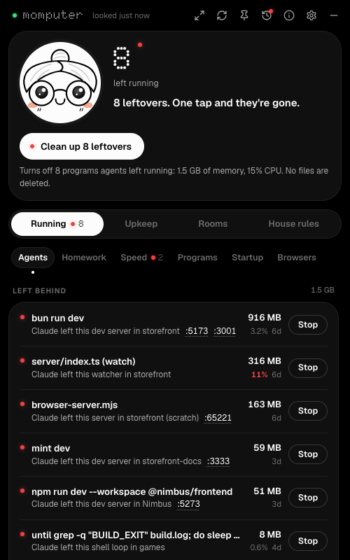

### Your agents never clean up. Mom does.

AI agents start dev servers, watchers and headless browsers, and nobody turns them off. A week later seventy copies of `node` are still running and your disk is full of scratch folders.

**momputer** knows which agent started what, shows you what was left behind, and cleans it up, after showing you exactly what she's about to do. And since she's in the house anyway, she looks after the rest of your computer too.

- **One press** turns off everything your agents left running.
- **Nothing goes unseen**: she shows you what it is first, then you confirm.
- **Nothing leaves your computer**. She only asks the internet whether there's a newer mom.
- **A small widget** when you want her out of the way, **BIG MODE** when you want the whole picture.

<br clear="right">

<p align="center">
  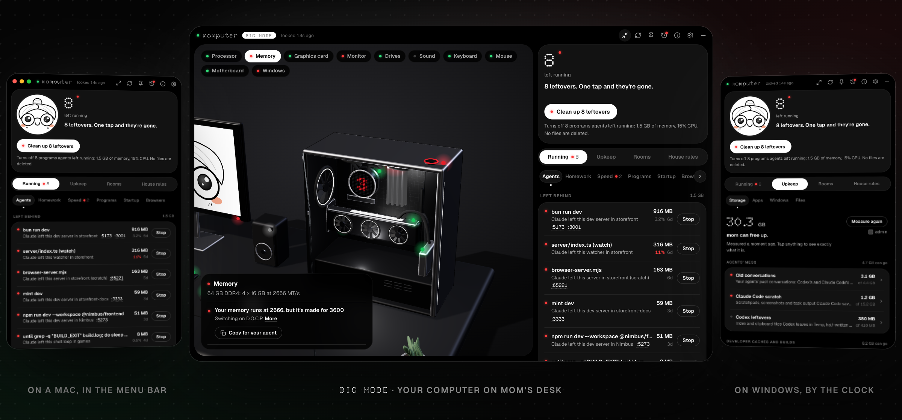
</p>

<p align="center"><a href="https://thisisily.github.io/momputer/"><b>Try her in your browser</b></a>: the widget on her page is live, with made-up data.</p>

## What she does

<table>
  <tr>
    <td width="33%" valign="top">
      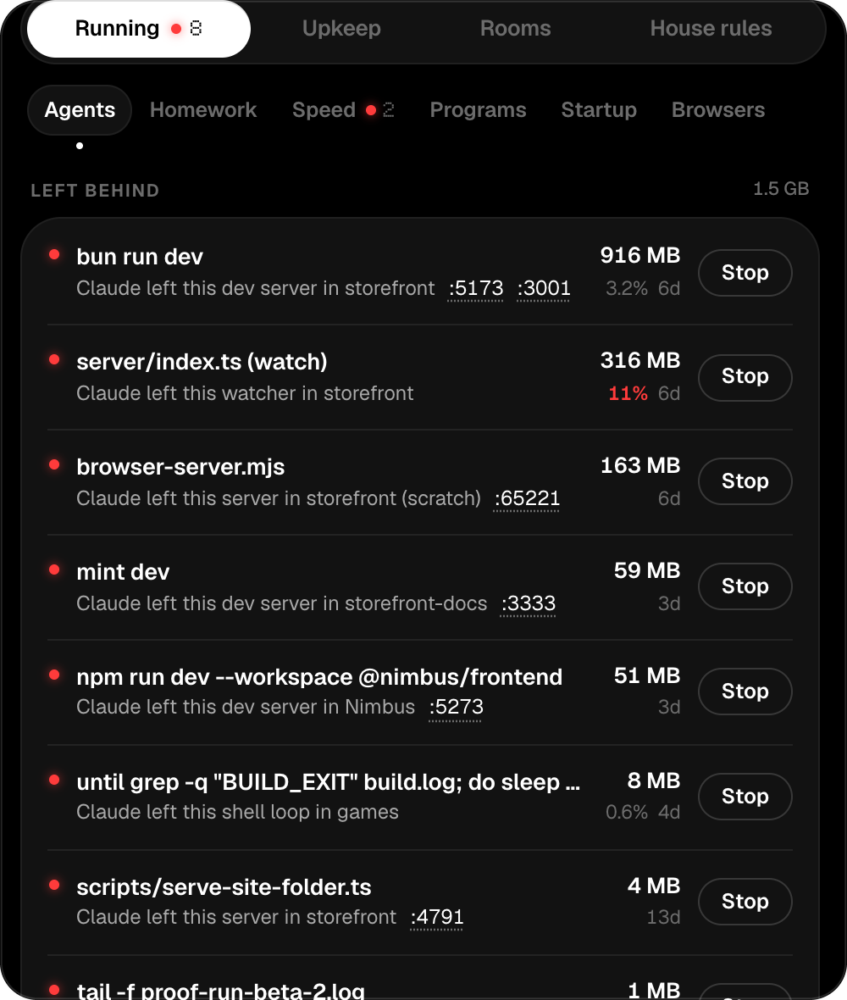
      <p><b>Running</b><br>Everything your agents started, who started it, and one button to stop what was left behind.</p>
    </td>
    <td width="33%" valign="top">
      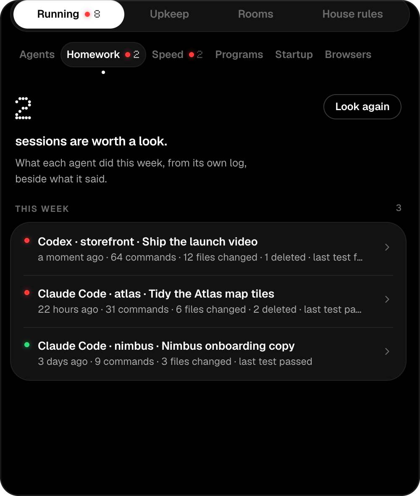
      <p><b>Homework</b><br>What each agent session changed, and whether what it told you matches its last test run.</p>
    </td>
    <td width="33%" valign="top">
      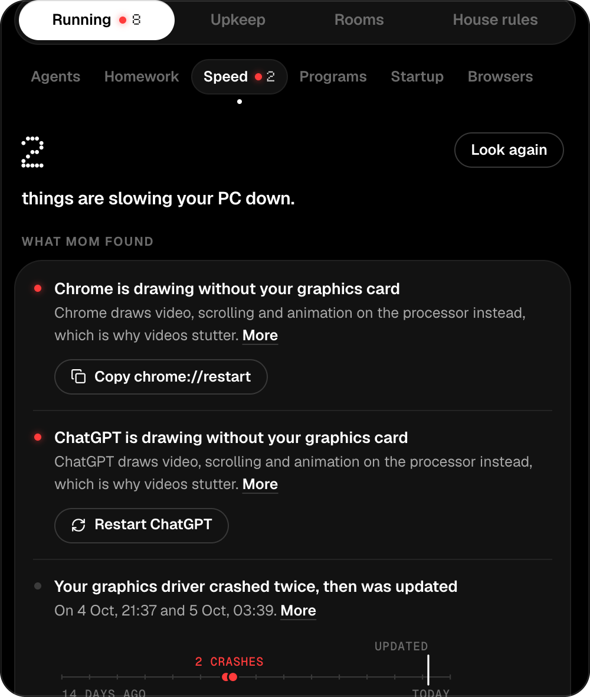
      <p><b>Speed</b><br>Why the computer feels slow right now. Each reason comes with its fix.</p>
    </td>
  </tr>
  <tr>
    <td width="33%" valign="top">
      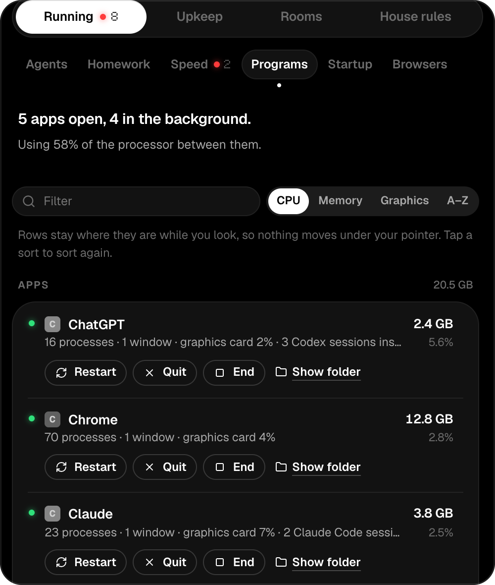
      <p><b>Programs and Startup</b><br>What's open, as one line per app, and what starts by itself, with a switch for each.</p>
    </td>
    <td width="33%" valign="top">
      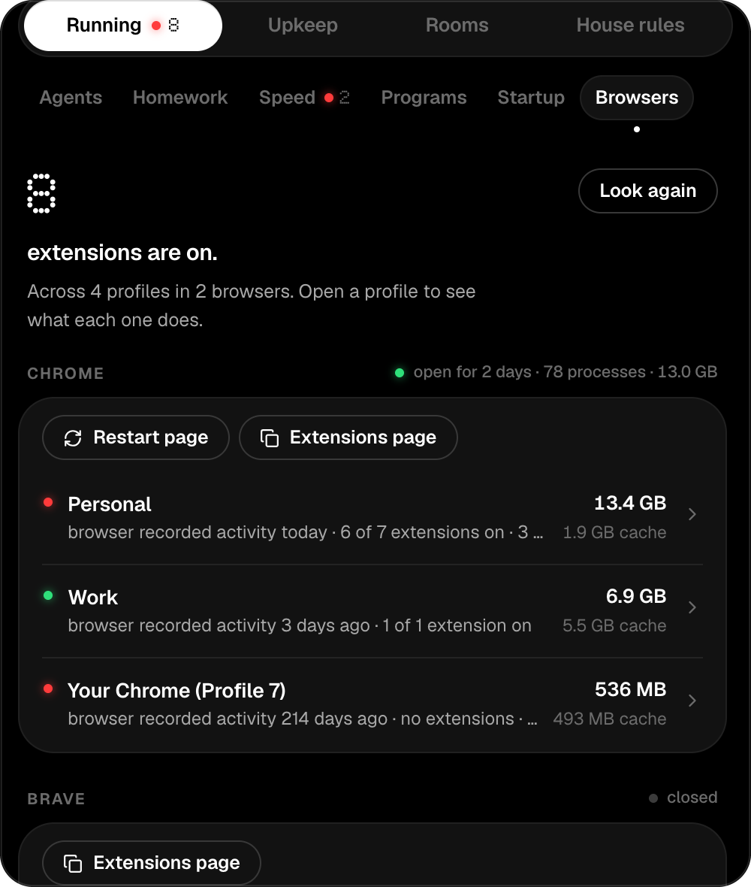
      <p><b>Browsers</b><br>Every profile and every extension: what it can read, and whether you still use it.</p>
    </td>
    <td width="33%" valign="top">
      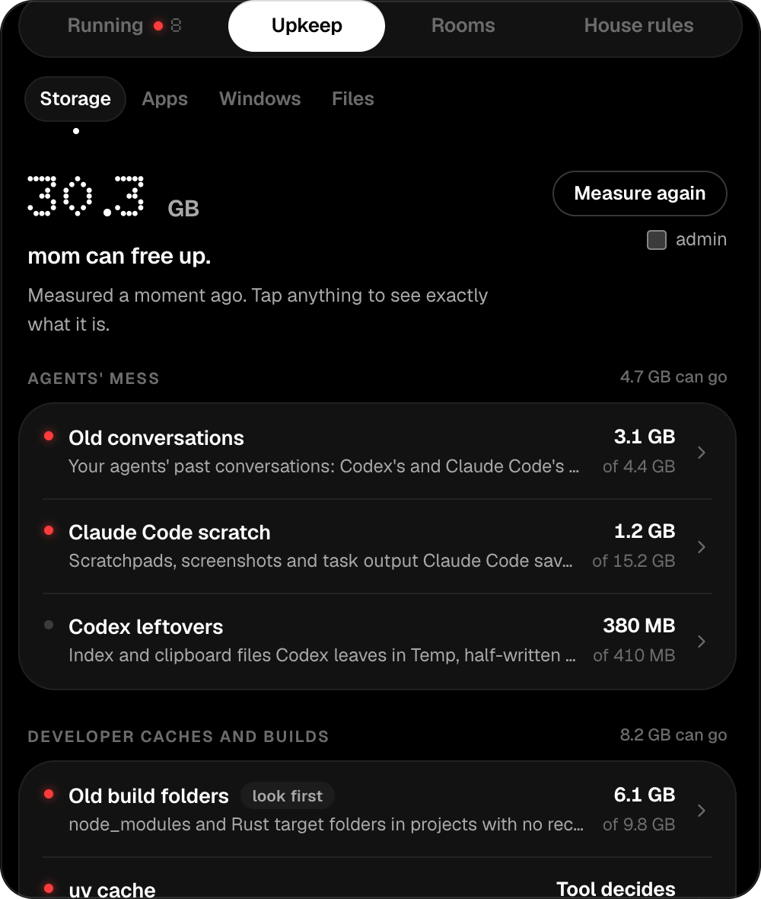
      <p><b>Storage</b><br>What can be deleted, and exactly what it is, before anything goes.</p>
    </td>
  </tr>
  <tr>
    <td width="33%" valign="top">
      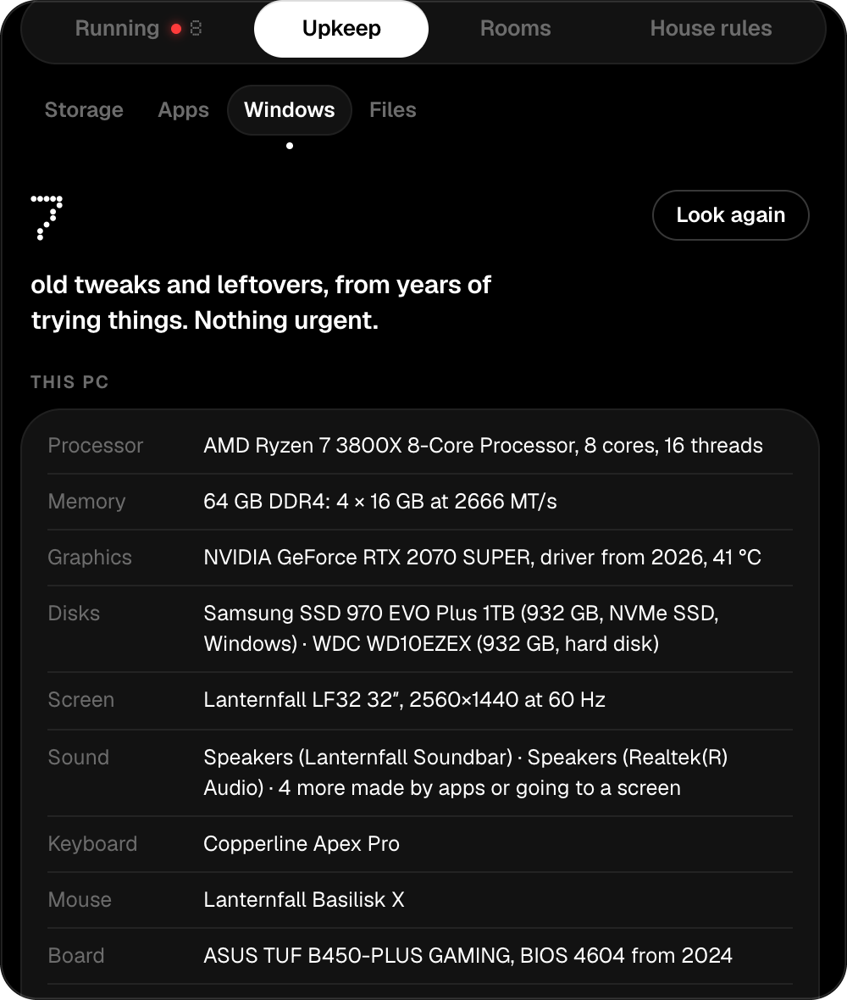
      <p><b>Checkup</b><br>The computer itself: what's wrong, and the button that fixes it.</p>
    </td>
    <td width="33%" valign="top">
      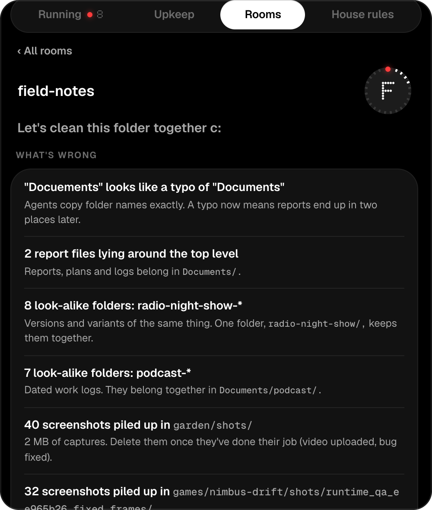
      <p><b>Rooms</b><br>Point her at a messy folder. She grades it and tidies it, with undo.</p>
    </td>
    <td width="33%" valign="top">
      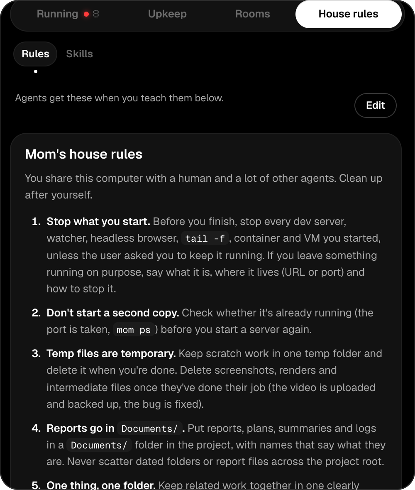
      <p><b>House rules</b><br>One set of rules every agent is given, and checked against.</p>
    </td>
  </tr>
</table>

And the rest of the housekeeping:

| | |
| --- | --- |
| **Apps** | The ones with no sign of use in a year, and the games nobody played in one. |
| **Files** | Copies of the same file, and big files nobody opened in a year. |
| **Backups** | What isn't backed up, and work that exists only on this computer. |
| **Autopilot** | Off until you say: once a week she clears the safe things herself. A Sunday letter says how the week went, and "What I did" keeps it all, with undo. |

Want every detail? [momputer, in detail](docs/in-detail.md).

## Meet mom

<p align="center">
  
</p>

She looks around every few seconds. Green lights are in use, red ones were left behind. She watches your pointer, blushes when you hover, and giggles when you poke her.

## BIG MODE

<p align="center">
  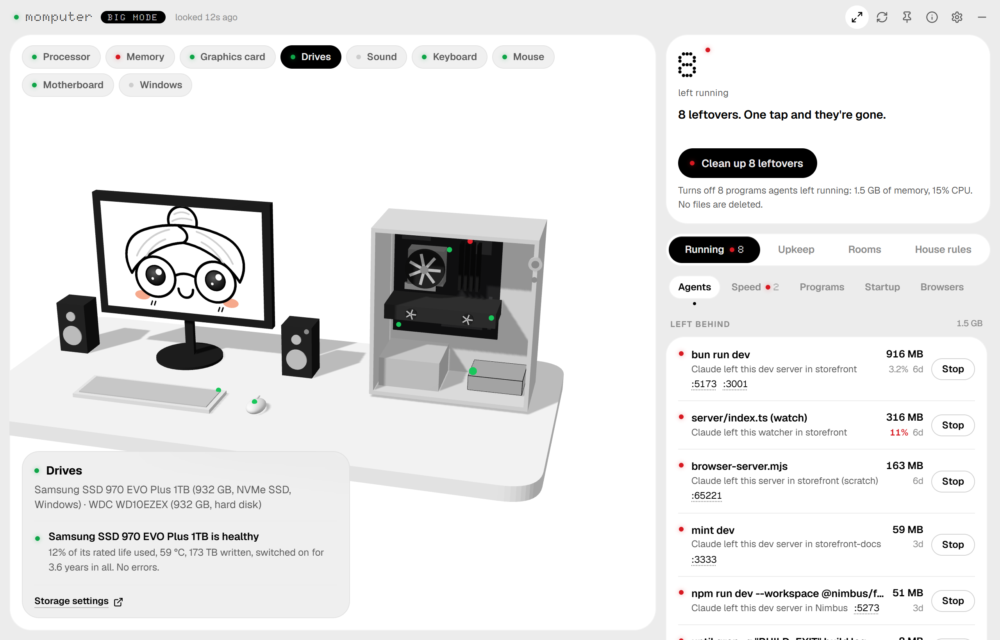
</p>

One button and the widget becomes a full window with your computer on mom's desk, drawn with the parts it really has. Each part has a light: green is fine, red needs a look. Tap one and mom tells you what's wrong and how to fix it.

## Windows and Mac

She started on Windows. The Mac version is new, and does nearly all of it.

| | Windows | Mac |
| --- | --- | --- |
| **Running** and **Homework** | Yes | Yes |
| **Speed** | Lost graphics card, driver crashes, hardware errors, what's busy | Heat, memory parked on the disk, crashes and unexpected shutdowns, what's busy |
| **Programs** and **Browsers** | Yes | Yes |
| **Startup** | Everything that starts with Windows | Launch agents and daemons |
| **Storage** | Agents' mess, developer caches, Windows' own leftovers | Agents' mess, developer caches, Xcode's build data, dead simulators, Homebrew's downloads |
| **Apps** | Opens each app's own uninstaller | Moves the app to the Trash |
| **Checkup** | Drives, memory, graphics, screens, devices, network, sleep, sound, updates and Windows settings | FileVault, Gatekeeper, the firewall, sharing, the screen lock, updates, the disk, the battery and Time Machine |
| **Files**, **Rooms**, **House rules**, **Autopilot**, **BIG MODE** | Yes | Yes |
| **Getting her** | A download | Build it yourself, for now |

<table>
  <tr>
    <td width="50%" valign="top">
      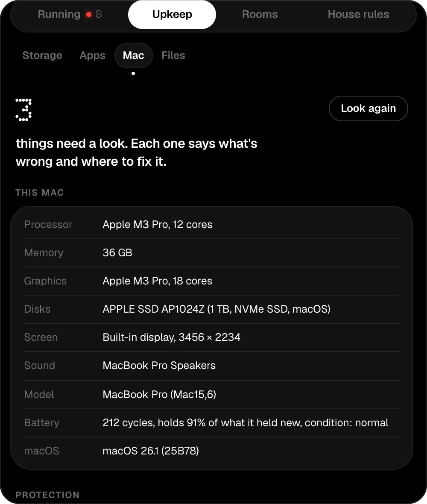
      <p><b>The Mac's checkup</b><br>What it's made of, whether it's locked, shared, updated and backed up, and how its disk and battery are holding up.</p>
    </td>
    <td width="50%" valign="top">
      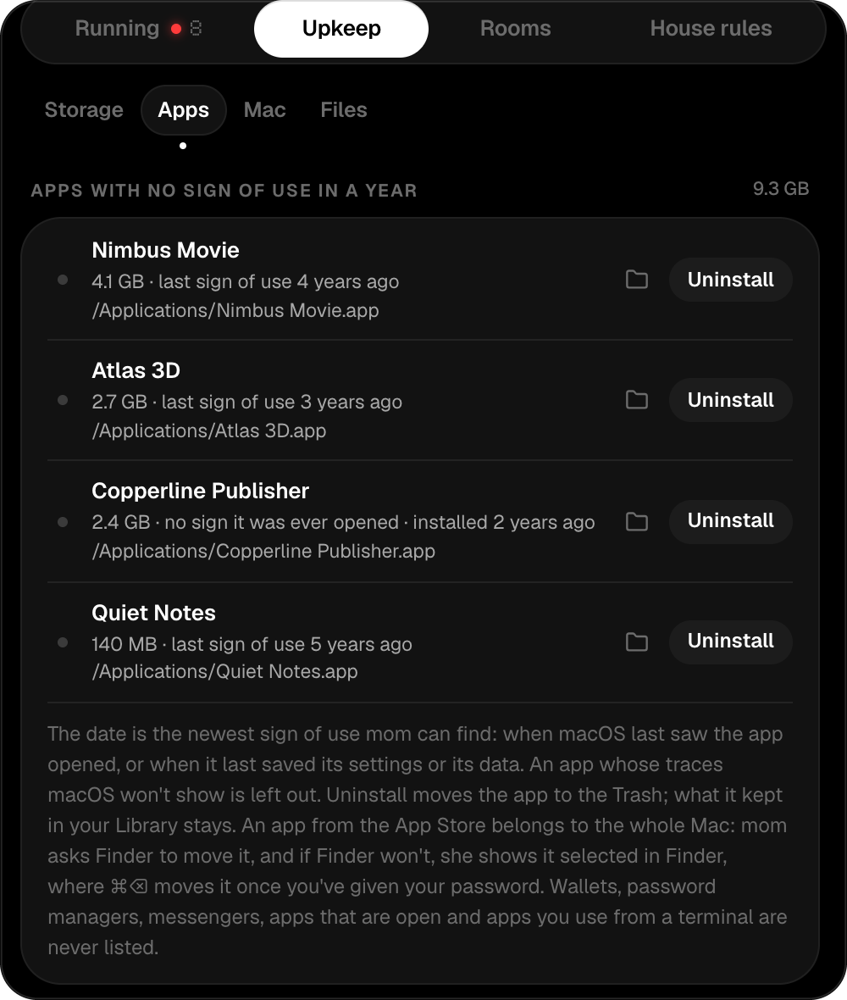
      <p><b>Apps nobody opens</b><br>Dated by the newest sign of use she can find. Uninstall moves one to the Trash.</p>
    </td>
  </tr>
</table>

Not on a Mac yet: emptying the Trash, the clean-ups that need an administrator, and apps set to open at login (those are in System Settings).

## Install

### On Windows

**[Download for Windows](https://thisisily.github.io/momputer/)**: one button, three steps.

It isn't code-signed yet, so Windows warns that it's from an unknown publisher. Choose **More info**, then **Run anyway**.

Mom lives by the clock. Click her for the widget. The arrows in its title bar are BIG MODE. When a newer version is out, a red light shows on the "i", with the button to get it.

<details>
<summary>Build it from source</summary>

```powershell
git clone https://github.com/thisisily/momputer
cd momputer
.\scripts\build.ps1
```

You need Rust 1.95+, the MSVC build tools and WebView2 (already on Windows 11). The script builds `mom.exe` and the installer (`target\release\bundle\`). To try it without installing:

```powershell
cargo build --release -p mom-cli -p momputer
.\target\release\momputer.exe
```

Run from a folder of your own like this, it all works except the clean-ups that need an administrator: mom won't ask for one from a folder anything running as you could change.

</details>

### On a Mac

It isn't a download yet (that needs Apple's signing), so build it:

```sh
git clone https://github.com/thisisily/momputer
cd momputer
./scripts/build.sh --app
open target/release/bundle/macos/momputer.app
```

You need Rust 1.95+ and Xcode's command line tools (`xcode-select --install`). Mom lives in the menu bar. Click her for the widget; the red button tucks her away again.

macOS asks before she looks in Downloads, Documents or the Desktop, and before she asks Finder to move an app that belongs to the whole Mac. A copy you built yourself is a new app to macOS each time you build it, so it asks again.

## For your agents

- **The `mom` command**: `mom leftovers`, `mom stop mine`, `mom trash`, `mom pc` and more, with `--json` for scripts. [Every command](docs/in-detail.md#the-mom-command).
- **Hooks**: she checks in before an agent says it's done, and asks it to stop what it started. [How](docs/in-detail.md#give-every-agent-a-mom).
- **Skills**: eleven of them. Tidy your folders, desktop, inbox, calendar, bookmarks and subscriptions, in Claude Code or Codex. They work without momputer. [All of them](skills).
  In Claude Code: `/plugin install momputer-skills --marketplace Thisisily/momputer`. The widget lists them, with what to say, under House rules > Skills, and tells you when your agent's copy is behind.
- **Agent health**: every MCP server, hook and setting your agents have. One button asks Claude Code which of its servers answer and which are waiting for a sign-in. Tap anything to read its file in BIG MODE, with keys blanked. [How](docs/in-detail.md#agent-health).

## What mom will never do

- Delete anything without showing you first. You press, then you confirm.
- Stop the system's own processes, an agent itself, or anything you marked "keep".
- Throw your own files away for good: those go to the Recycle Bin (the Trash, on a Mac).
- Send anything about you or your computer anywhere. The one thing she asks the internet is whether there's a newer version, and you can switch that off.
- Ask for administrator rights from a copy something else could have swapped.

[The full list, and how she knows who left what](docs/in-detail.md#how-mom-knows-who-did-it).

## Contributing

Teach mom a new agent, a new kind of trash, or a new face: [CONTRIBUTING.md](CONTRIBUTING.md).

## Code signing

Releases are built from this repository by GitHub Actions and aren't code-signed yet. [How signing is set up](docs/signing.md).

Privacy: momputer sends nothing about you or your computer anywhere. Once a day it asks GitHub whether there's a newer version (the same request from every copy); Settings turns that off.

## Roadmap

- **The rest of the Mac version** (a signed download, the Trash, administrator clean-ups), then Linux.
- **Out of date**: which apps and global packages (winget, npm, pip, uv, cargo, scoop, Chocolatey) have a newer version, and one button to update them.
- **Known holes**: a vulnerability checker for versions with known security problems, the ones attackers already use first.
- **winget**: install momputer with one command.
- **An MCP server**, so agents can ask mom directly.
- **More mom**: bedtime (a nightly tidy-up), screen time for agents, a nudge when a disk is nearly full.

How each one would work: [docs/roadmap.md](docs/roadmap.md).

## Built with

- [Tauri](https://tauri.app) for the app.
- [GSAP](https://gsap.com) for mom's animation, free under GreenSock's [standard license](https://gsap.com/standard-license).
- [idiomorph](https://github.com/bigskysoftware/idiomorph) (0BSD), so lists update in place.
- [Geist](https://vercel.com/font) and [Doto](https://github.com/oliverlalan/Doto) fonts, under the SIL Open Font License.
- [Lucide](https://lucide.dev) icons (ISC).
- [Simple Icons](https://simpleicons.org) (CC0) for the coin and GitHub marks.
- [three.js](https://threejs.org) (MIT), for the desk in BIG MODE, and for something you'll have to find.

## Made by

Hi! I'm Ilya Arbabi and I built momputer because my desktop was a mess. Every AI agent I worked with made it worse, so I made my computer a mom. More from me: [Marsell](https://getmarsell.com) and [Ilisium](https://ilisium.xyz).

momputer is free for personal use. If she saved you an afternoon, you can buy mom a coffee:

| | |
|---|---|
| Solana | `5qT8edyi62wwLz9UBTiRVoN3S9UXLjbV2YVEu4GJH3zH` |
| Zcash | `t1cYbXWEXXc6kZYR1JjkE2qRCEmzCpMA371` |
| Ethereum | `0xfFa448F43896Cf8227aAceF3A72b80450e1fF86E` |
| Bitcoin | `bc1qmnw03rsastc08g6zutgx2sdarzapz82q5nn2kd` |

## License

momputer is free for personal use: at home, for hobby projects, if you're a student, at a nonprofit, and for research. That's the [PolyForm Noncommercial License 1.0.0](LICENSE), which has the details.

If you use it for work at a company, you need a commercial license. [Open an issue with the Commercial license template](https://github.com/Thisisily/momputer/issues/new?template=commercial-license.yml), say a little about how you'd use it, and we'll sort it out.

The skills in [`skills/`](skills) are separate: they're under the [Apache License 2.0](skills/LICENSE.txt), free for any use, companies included.

The Marsell and Ilisium logos on the About page belong to those projects and aren't covered by this license.
