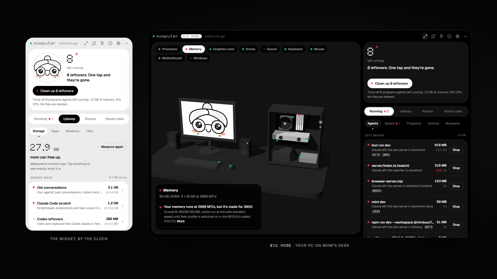
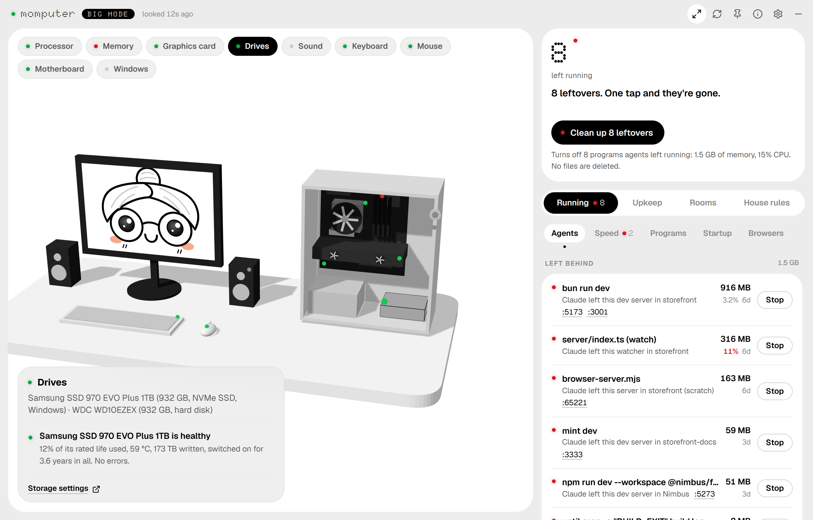
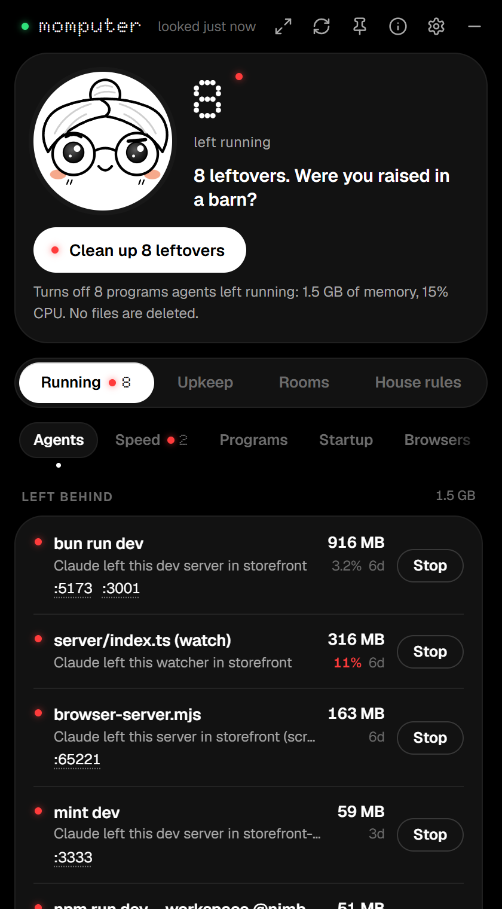
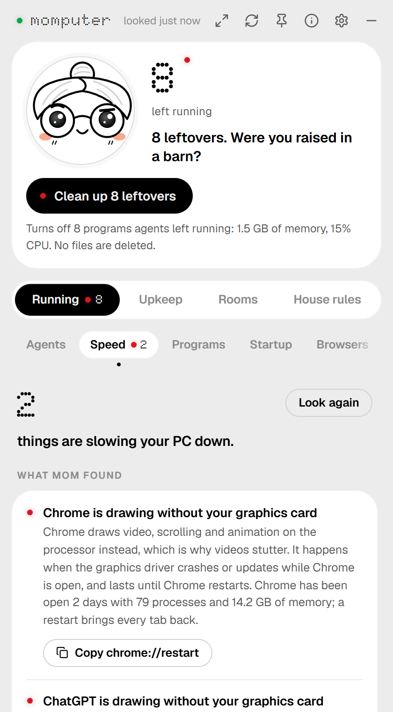
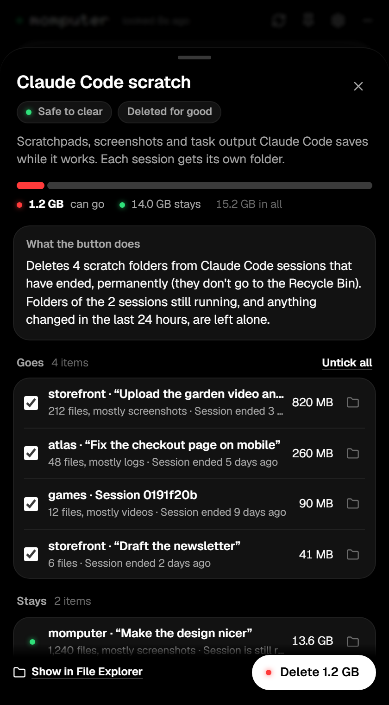
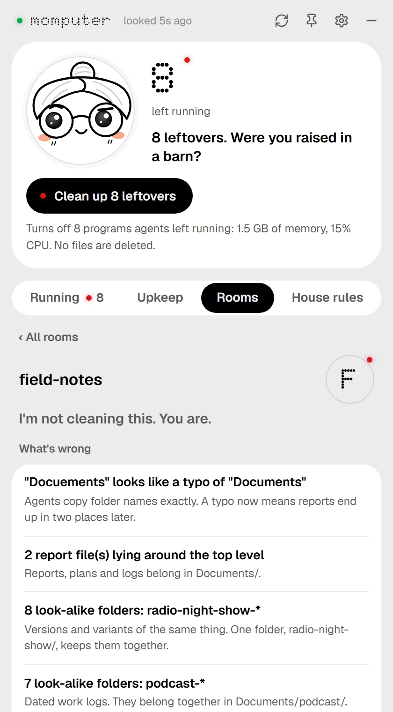

<p align="center">
  
</p>

<p align="center">
  <a href="https://thisisily.github.io/momputer/"></a>
  
  <a href="#license"></a>
  <a href="#big-mode"></a>
  <a href="skills"></a>
  <br>
  
</p>

<p align="center"><b>A mom for you, your computer and your AIs.</b><br>
<sub>She turns off what AI agents left running, frees up disk space, checks your drives, memory, sound and Windows settings, and tidies your folders. A small widget by the clock when you want her out of the way, and BIG MODE when you want the whole picture. She always shows you first.</sub></p>

<p align="center">
  
</p>

<p align="center"><a href="https://thisisily.github.io/momputer/"><b>Try her in your browser</b></a>: the widget on her page is live, with made-up data.</p>

---

AI agents start dev servers, watchers and headless browsers, and nobody turns them off. A week later Task Manager has 70 `node.exe` and your disk is full of scratch folders.

**momputer** knows which agent started what, shows you what was left behind, and cleans it up, after showing you exactly what she's about to do. And since she's in the house anyway, she looks after the rest of your PC too.

## Meet mom

<p align="center">
  
</p>

She looks around every few seconds. Green lights are in use, red ones were left behind. She watches your pointer, blushes when you hover, and giggles when you poke her.

## BIG MODE

<p align="center">
  
</p>

One button and the widget becomes a full window with your PC on mom's desk, drawn with the parts it really has. Each part has a light: green is fine, red needs a look. Tap one and mom tells you what's wrong and how to fix it.

## What she does

| | |
| --- | --- |
| **Running** | Everything your agents started, who started it, and one button to stop what was left behind. |
| **Speed** | Why the PC feels slow right now. Each reason comes with its fix. |
| **Programs, Startup, Browsers** | What's open, what starts with Windows, and every browser extension, with a switch for each. |
| **Storage** | What can be deleted, and exactly what it is, before anything goes. |
| **Checkup** | Drives, memory, graphics, sound, keyboard and mouse, updates and Windows settings: what's wrong, and the button that fixes it. |
| **Files** | Copies of the same file, and big files nobody opened in a year. |
| **Rooms** | Point her at a messy folder. She grades it and tidies it, with undo. |
| **House rules** | One set of rules every agent is given, and checked against. |

<p align="center">
  
  
  
  
</p>

Want every detail? [momputer, in detail](docs/in-detail.md).

## Install

**0.3.3:** shader caches carry their game's name, and a game's cache goes once the game is
uninstalled. Other file cleanup is paused while its safety update is checked; scans and
previews work as before.

**[Download for Windows](https://thisisily.github.io/momputer/)**: one button, three steps.

It isn't code-signed yet, so Windows may show an unknown-publisher warning. A malware detection
is different: leave any detected file quarantined and do not bypass antivirus protection.

Mom lives by the clock. Click her for the widget. The arrows in its title bar are BIG MODE. When a newer version is out, a red light shows on the "i", with the button to get it.

<details>
<summary>Build it from source</summary>

```powershell
git clone https://github.com/thisisily/momputer
cd momputer
.\scripts\build.ps1
```

You need Rust 1.90+, the MSVC build tools and WebView2 (already on Windows 11). The script builds `mom.exe` and the installer (`target\release\bundle\`). To try it without installing:

```powershell
cargo build --release -p mom-cli -p momputer
.\target\release\momputer.exe
```

Run from a folder of your own like this to try the app. General file cleanup remains disabled,
including in source builds and the CLI. The widget's dedicated NVIDIA/Steam shader operation
uses explicit selections from a fresh, single-use scan; it never calls general cleanup.

</details>

## For your agents

- **The `mom` command**: `mom leftovers`, `mom stop mine`, `mom trash`, `mom pc` and more, with `--json` for scripts. [Every command](docs/in-detail.md#the-mom-command).
- **Hooks**: she checks in before an agent says it's done, and asks it to stop what it started. [How](docs/in-detail.md#give-every-agent-a-mom).
- **Skills**: eleven of them. Tidy your folders, desktop, inbox, calendar, bookmarks and subscriptions, in Claude Code or Codex. They work without momputer. [All of them](skills).
  In Claude Code: `/plugin install momputer-skills --marketplace Thisisily/momputer`. The widget lists them, with what to say, under House rules > Skills, and tells you when your agent's copy is behind.
- **Agent health**: every MCP server, hook and setting your agents have. One button asks Claude Code which of its servers answer and which are waiting for a sign-in. Tap anything to read its file in BIG MODE, with keys blanked. [How](docs/in-detail.md#agent-health).

## What mom will never do

- Delete anything without showing you first. You press, then you confirm.
- Stop Windows' own processes, an agent itself, or anything you marked "keep".
- Throw your own files away for good: those go to the Recycle Bin.
- Send anything about you or your PC anywhere. The one thing she asks the internet is whether there's a newer version, and you can switch that off.
- Ask for administrator rights from a copy something else could have swapped.

[The full list, and how she knows who left what](docs/in-detail.md#how-mom-knows-who-did-it).

## Contributing

Teach mom a new agent, a new kind of trash, or a new face: [CONTRIBUTING.md](CONTRIBUTING.md).

## Code signing

Releases are built from this repository by GitHub Actions and aren't code-signed yet. [How signing is set up](docs/signing.md).

Privacy: momputer sends nothing about you or your PC anywhere. Once a day it asks GitHub whether there's a newer version (the same request from every copy); Settings turns that off.

## Roadmap

- winget.
- macOS and Linux (the core is mostly portable already).
- An MCP server, so agents can ask mom directly.
- More mom: bedtime (a nightly tidy-up), screen time for agents, a nudge when a disk is nearly full.

## Built with

- [Tauri](https://tauri.app) for the app.
- [GSAP](https://gsap.com) for mom's animation, free under GreenSock's [standard license](https://gsap.com/standard-license).
- [idiomorph](https://github.com/bigskysoftware/idiomorph) (0BSD), so lists update in place.
- [Geist](https://vercel.com/font) and [Doto](https://github.com/oliverlalan/Doto) fonts, under the SIL Open Font License.
- [Lucide](https://lucide.dev) icons (ISC).
- [Simple Icons](https://simpleicons.org) (CC0) for the coin and GitHub marks.
- [three.js](https://threejs.org) (MIT), for the desk in BIG MODE, and for something you'll have to find.

## Made by

Hi! I'm Ilya Arbabi and I built momputer because my desktop was a mess. Every AI agent I worked with made it worse, so I made my computer a mom. More from me: [Marsell](https://getmarsell.com) and [Ilisium](https://ilisium.xyz).

momputer is free for personal use. If she saved you an afternoon, you can buy mom a coffee:

| | |
|---|---|
| Solana | `5qT8edyi62wwLz9UBTiRVoN3S9UXLjbV2YVEu4GJH3zH` |
| Zcash | `t1cYbXWEXXc6kZYR1JjkE2qRCEmzCpMA371` |
| Ethereum | `0xfFa448F43896Cf8227aAceF3A72b80450e1fF86E` |
| Bitcoin | `bc1qmnw03rsastc08g6zutgx2sdarzapz82q5nn2kd` |

## License

momputer is free for personal use: at home, for hobby projects, if you're a student, at a nonprofit, and for research. That's the [PolyForm Noncommercial License 1.0.0](LICENSE), which has the details.

If you use it for work at a company, you need a commercial license. [Open an issue with the Commercial license template](https://github.com/Thisisily/momputer/issues/new?template=commercial-license.yml), say a little about how you'd use it, and we'll sort it out.

The skills in [`skills/`](skills) are separate: they're under the [Apache License 2.0](skills/LICENSE.txt), free for any use, companies included.

The Marsell and Ilisium logos on the About page belong to those projects and aren't covered by this license.
